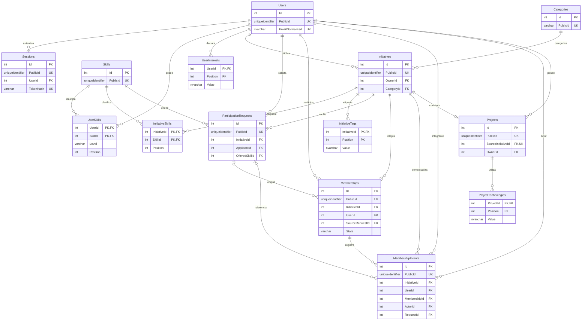

# Innovation Hub — Modelo relacional (SQL Server)

**Universidad CENFOTEC · SOFT-12 · Tarea 3, Parte B**  
**Integrantes:** Daniel Campos Sánchez y Francisco José Torres Sandoval.  
**Docente:** Álvaro Cordero Peña · III cuatrimestre de 2026.

Diseño para la futura API .NET con EF Core. No se ha creado ni ejecutado una base de datos SQL Server. El punto de partida es el Avance 2: `servidor/src/models/`, `servidor/src/validation/`, `servidor/src/services/`, `servidor/src/dto/`, `pruebas/fixtures/` y [contrato HTTP](api-contract.md). Se mantienen las reglas y la respuesta JSON del servidor Express.

## Diagrama

Se proponen 14 tablas: nueve proceden de las colecciones existentes y cinco reemplazan sus arreglos. Las relaciones se representan con notación pata de cuervo. PK = llave primaria, FK = llave foránea y UK = llave única. El equipo de un proyecto es el equipo de la iniciativa de origen, no una segunda copia de sus integrantes.

### Relaciones solicitadas

| Relación | Tipo | Resolución |
| --- | --- | --- |
| Usuario–competencia | Muchos a muchos | `UserSkills` une `Users` y `Skills` mediante dos FK y conserva el nivel. |
| Usuario–iniciativa | Uno a muchos (propiedad) | `Initiatives.OwnerId → Users.Id`. Un usuario puede publicar varias iniciativas, cada una tiene un propietario. |
| Iniciativa–competencia | Muchos a muchos | `InitiativeSkills` contiene FK a `Initiatives` y `Skills`. |
| Iniciativa–solicitud | Uno a muchos | `ParticipationRequests.InitiativeId → Initiatives.Id`. |
| Proyecto–usuario | Muchos a muchos | `Memberships` es la tabla intermedia entre usuarios e iniciativas; `Projects.SourceInitiativeId` identifica el equipo reutilizado. Un JOIN `Projects → Memberships → Users` recupera sus integrantes activos. No se crea una tabla ProyectoUsuario redundante. |
| Proyecto–iniciativa | Uno a cero o uno (caso restringido de uno a muchos) | `Projects.SourceInitiativeId → Initiatives.Id` con UNIQUE: una iniciativa puede no tener proyecto, pero nunca dos. Cada proyecto procede de una iniciativa. |

### Del documento a la tabla

| Colección o arreglo de MongoDB | Tabla SQL Server | Correspondencia y justificación |
| --- | --- | --- |
| `users` | `Users` | Una fila por usuario; conserva datos personales y autenticación. |
| `users.skills[]` (`skillId`, `level`) | `UserSkills` | Relación N:M; nivel propio de cada relación, FK a usuario y competencia. |
| `users.interests[]` | `UserInterests` | Una fila por interés; orden y límites sin listas separadas por comas. |
| `sessions` | `Sessions` | Una fila por sesión; `userId → UserId`, hash único y fecha de expiración. |
| `categories` | `Categories` | Catálogo; conserva slug estable en `PublicId`. |
| `skills` | `Skills` | Catálogo reutilizable; UUID en `PublicId`. |
| `initiatives` | `Initiatives` | `ownerId → OwnerId` y `categoryId → CategoryId`; mantiene estados y visibilidad. |
| `initiatives.skillIds[]` | `InitiativeSkills` | N:M, dos FK y posición para reconstruir el arreglo. |
| `initiatives.tags[]` | `InitiativeTags` | Hijas de iniciativa; cada etiqueta se consulta individualmente. |
| `requests` | `ParticipationRequests` | `initiativeId → InitiativeId`, `applicantId → ApplicantId`, `offeredSkillId → OfferedSkillId`. Historial y solicitudes pendientes únicas. |
| `memberships` | `Memberships` | `initiativeId → InitiativeId`, `userId → UserId`, `sourceRequestId → SourceRequestId` opcional; conserva periodos y roles. |
| `membershipEvents` | `MembershipEvents` | `initiativeId`, `userId`, `membershipId`, `actorId`, `requestId` se convierten a FK numéricas homónimas; historial de ingreso y retiro. |
| `projects` | `Projects` | `sourceInitiativeId → SourceInitiativeId` único, `ownerId → OwnerId`; comparte equipo con iniciativa. |
| `projects.technologies[]` | `ProjectTechnologies` | Una fila por tecnología y posición; no se inventa un catálogo de tecnologías ajeno al Avance 2. |

## Tablas

Convenciones: `Id INT IDENTITY(1,1)` es interno; `PublicId UNIQUEIDENTIFIER` conserva el UUID público original excepto categorías, que conservan su slug. Los tipos `DATETIME2(3)` almacenan instantes UTC y `DATE` almacena fechas sin hora. Las PK compuestas identifican las filas dependientes sin otro autoincremental. En cada FK, **NO ACTION** impide borrar el padre referenciado; **CASCADE** elimina únicamente filas hijas sin ciclo de vida independiente. No se usa SET NULL para borrar hechos históricos, aunque algunas referencias admiten NULL desde su creación.

### 1. Users

| Columna | Tipo | ¿Obligatoria? | Llave | Regla |
| --- | --- | --- | --- | --- |
| Id | INT IDENTITY | Sí | Primaria | Positiva. |
| PublicId | UNIQUEIDENTIFIER | Sí | UNIQUE | UUID v4 inmutable; API `id`. |
| FirstName | NVARCHAR(60) | Sí | | 2–60 caracteres. |
| LastName | NVARCHAR(80) | Sí | | 2–80 caracteres. |
| MemberType | VARCHAR(20) | Sí | | CHECK: student, professor, administrative, graduate, external. |
| Email | NVARCHAR(254) | Sí | | Formato correo, no editable desde perfil. |
| EmailNormalized | NVARCHAR(254) | Sí | UNIQUE | Minúsculas y sin espacios externos. |
| PasswordHash | VARCHAR(255) | Sí | | Hash scrypt con sal, nunca contraseña en claro. |
| Career | NVARCHAR(120) | No | | NULL si no se informa. |
| Bio | NVARCHAR(600) | No | | NULL si no se informa. |
| Availability | VARCHAR(10) | Sí | | CHECK low, medium, high; DEFAULT medium. |
| PortfolioUrl | NVARCHAR(2048) | No | | URL HTTP(S) válida o NULL. |
| Active | BIT | Sí | | DEFAULT 1. |
| CreatedAt | DATETIME2(3) | Sí | | UTC, inmutable. |
| UpdatedAt | DATETIME2(3) | Sí | | CHECK UpdatedAt >= CreatedAt. |

### 2. Categories

| Columna | Tipo | ¿Obligatoria? | Llave | Regla |
| --- | --- | --- | --- | --- |
| Id | INT IDENTITY | Sí | Primaria | Positiva. |
| PublicId | VARCHAR(80) | Sí | UNIQUE | Slug inmutable. |
| Name | NVARCHAR(80) | Sí | | 2–80 caracteres. |
| NameNormalized | NVARCHAR(80) | Sí | UNIQUE | Normalizado sin tildes, minúsculas. |
| Active | BIT | Sí | | DEFAULT 1; desactivar conserva referencias. |

### 3. Skills

| Columna | Tipo | ¿Obligatoria? | Llave | Regla |
| --- | --- | --- | --- | --- |
| Id | INT IDENTITY | Sí | Primaria | Positiva. |
| PublicId | UNIQUEIDENTIFIER | Sí | UNIQUE | UUID v4 inmutable. |
| Name | NVARCHAR(80) | Sí | | 2–80 caracteres. |
| NameNormalized | NVARCHAR(80) | Sí | UNIQUE | Nombre normalizado. |
| Active | BIT | Sí | | DEFAULT 1. |

### 4. Sessions

| Columna | Tipo | ¿Obligatoria? | Llave | Regla |
| --- | --- | --- | --- | --- |
| Id | INT IDENTITY | Sí | Primaria | Positiva. |
| PublicId | UNIQUEIDENTIFIER | Sí | UNIQUE | UUID v4 inmutable. |
| UserId | INT | Sí | Foránea → Users.Id | ON DELETE NO ACTION. |
| TokenHash | VARCHAR(43) | Sí | UNIQUE | SHA-256 codificado base64url, no token en claro. Usar collation binaria. |
| ExpiresAt | DATETIME2(3) | Sí | | CHECK ExpiresAt > CreatedAt; índice. |
| RevokedAt | DATETIME2(3) | No | | NULL si no revocada; si existe >= CreatedAt. |
| CreatedAt | DATETIME2(3) | Sí | | UTC. |

### 5. UserSkills

| Columna | Tipo | ¿Obligatoria? | Llave | Regla |
| --- | --- | --- | --- | --- |
| UserId | INT | Sí | Primaria compuesta; foránea → Users.Id | ON DELETE CASCADE. |
| SkillId | INT | Sí | Primaria compuesta; foránea → Skills.Id | ON DELETE NO ACTION. |
| Level | VARCHAR(15) | Sí | | CHECK basic, intermediate, advanced. |
| Position | INT | Sí | | CHECK 1–20; UNIQUE(UserId, Position). |

PK(UserId, SkillId): una competencia no se repite dentro del perfil. Máximo 20 competencias por perfil; competencia activa al asignar.

### 6. UserInterests

| Columna | Tipo | ¿Obligatoria? | Llave | Regla |
| --- | --- | --- | --- | --- |
| UserId | INT | Sí | Primaria compuesta; foránea → Users.Id | ON DELETE CASCADE. |
| Position | INT | Sí | Primaria compuesta | CHECK 1–15. |
| Value | NVARCHAR(40) | Sí | | 1–40 caracteres; UNIQUE(UserId, Value) con collation CI_AS. |

### 7. Initiatives

| Columna | Tipo | ¿Obligatoria? | Llave | Regla |
| --- | --- | --- | --- | --- |
| Id | INT IDENTITY | Sí | Primaria | Positiva. |
| PublicId | UNIQUEIDENTIFIER | Sí | UNIQUE | UUID v4 inmutable. |
| OwnerId | INT | Sí | Foránea → Users.Id | ON DELETE NO ACTION; propietario inmutable. |
| CategoryId | INT | Sí | Foránea → Categories.Id | ON DELETE NO ACTION; categoría activa al asignar. |
| Title | NVARCHAR(100) | Sí | | 5–100 caracteres. |
| Type | VARCHAR(10) | Sí | | CHECK idea, need, challenge. |
| Summary | NVARCHAR(240) | Sí | | 15–240 caracteres. |
| Description | NVARCHAR(2000) | Sí | | 20–2000 caracteres. |
| Problem | NVARCHAR(500) | Sí | | 10–500 caracteres. |
| Beneficiaries | NVARCHAR(150) | Sí | | 3–150 caracteres. |
| EstimatedMembers | INT | Sí | | CHECK 1–100; estimación, no cupo máximo. |
| Visibility | VARCHAR(15) | Sí | | CHECK public, institutional, restricted, private. |
| State | VARCHAR(20) | Sí | | CHECK draft, published, forming_team, converted, archived. |
| SearchText | NVARCHAR(1000) | Sí | | Derivado de título, resumen y tags; nunca se expone. |
| PublicSearchText | NVARCHAR(341) | Sí | | Título y resumen normalizados para búsquedas restringidas. |
| TitleNormalized | NVARCHAR(100) | Sí | | Derivado para ordenar. |
| Revision | INT | Sí | | CHECK >= 0; DEFAULT 0, token de concurrencia EF Core. |
| CreatedAt | DATETIME2(3) | Sí | | Inmutable, UTC. |
| UpdatedAt | DATETIME2(3) | Sí | | CHECK UpdatedAt >= CreatedAt. |

### 8. InitiativeSkills

| Columna | Tipo | ¿Obligatoria? | Llave | Regla |
| --- | --- | --- | --- | --- |
| InitiativeId | INT | Sí | Primaria compuesta; foránea → Initiatives.Id | ON DELETE CASCADE. |
| SkillId | INT | Sí | Primaria compuesta; foránea → Skills.Id | ON DELETE NO ACTION. |
| Position | INT | Sí | | CHECK 1–10; UNIQUE(InitiativeId, Position). |

PK(InitiativeId, SkillId). Cada iniciativa publicada requiere entre 1 y 10 competencias activas al asignar.

### 9. InitiativeTags

| Columna | Tipo | ¿Obligatoria? | Llave | Regla |
| --- | --- | --- | --- | --- |
| InitiativeId | INT | Sí | Primaria compuesta; foránea → Initiatives.Id | ON DELETE CASCADE. |
| Position | INT | Sí | Primaria compuesta | CHECK 1–10. |
| Value | NVARCHAR(40) | Sí | | 1–40 caracteres; UNIQUE(InitiativeId, Value) con collation CI_AI. |

### 10. ParticipationRequests

| Columna | Tipo | ¿Obligatoria? | Llave | Regla |
| --- | --- | --- | --- | --- |
| Id | INT IDENTITY | Sí | Primaria | Positiva. |
| PublicId | UNIQUEIDENTIFIER | Sí | UNIQUE | UUID v4 inmutable. |
| InitiativeId | INT | Sí | Foránea → Initiatives.Id | ON DELETE NO ACTION. |
| ApplicantId | INT | Sí | Foránea → Users.Id | ON DELETE NO ACTION. |
| OfferedSkillId | INT | Sí | Foránea → Skills.Id | ON DELETE NO ACTION; debe pertenecer al perfil al solicitar/editar. |
| Message | NVARCHAR(500) | Sí | | 15–500 caracteres. |
| Role | NVARCHAR(100) | Sí | | 3–100 caracteres. |
| Availability | VARCHAR(10) | Sí | | CHECK low, medium, high. |
| State | VARCHAR(10) | Sí | | CHECK pending, accepted, rejected, cancelled. |
| DecisionComment | NVARCHAR(500) | No | | NULL permitido. |
| CreatedAt | DATETIME2(3) | Sí | | UTC. |
| UpdatedAt | DATETIME2(3) | Sí | | CHECK >= CreatedAt. |
| DecidedAt | DATETIME2(3) | No | | Obligatoria al aceptar/rechazar, NULL pendiente/cancelada. |

Índice único filtrado `(InitiativeId, ApplicantId) WHERE State = 'pending'`; permite nuevos intentos sin borrar el historial.

### 11. Memberships

| Columna | Tipo | ¿Obligatoria? | Llave | Regla |
| --- | --- | --- | --- | --- |
| Id | INT IDENTITY | Sí | Primaria | Identifica un periodo de pertenencia. |
| PublicId | UNIQUEIDENTIFIER | Sí | UNIQUE | UUID v4 inmutable. |
| InitiativeId | INT | Sí | Foránea → Initiatives.Id | ON DELETE NO ACTION. |
| UserId | INT | Sí | Foránea → Users.Id | ON DELETE NO ACTION. |
| Role | NVARCHAR(150) | Sí | | 2–150 caracteres. |
| State | VARCHAR(10) | Sí | | CHECK active, retired. |
| JoinedAt | DATETIME2(3) | Sí | | UTC, inmutable. |
| RetiredAt | DATETIME2(3) | No | | NULL activa; retirada >= JoinedAt. |
| SourceRequestId | INT | No | Foránea → ParticipationRequests.Id | ON DELETE NO ACTION; NULL para dueño y legado. |

Índice único filtrado `(InitiativeId, UserId) WHERE State = 'active'`. La reincorporación genera otra fila. No se elimina la membresía para simular un retiro.

### 12. MembershipEvents

| Columna | Tipo | ¿Obligatoria? | Llave | Regla |
| --- | --- | --- | --- | --- |
| Id | INT IDENTITY | Sí | Primaria | Positiva. |
| PublicId | UNIQUEIDENTIFIER | Sí | UNIQUE | UUID v4 inmutable. |
| InitiativeId | INT | Sí | Foránea → Initiatives.Id | ON DELETE NO ACTION. |
| UserId | INT | Sí | Foránea → Users.Id | ON DELETE NO ACTION; integrante. |
| MembershipId | INT | Sí | Foránea → Memberships.Id | ON DELETE NO ACTION. |
| Type | VARCHAR(10) | Sí | | CHECK joined, retired. |
| OccurredAt | DATETIME2(3) | Sí | | UTC, inmutable. |
| ActorId | INT | Sí | Foránea → Users.Id | ON DELETE NO ACTION; quién ejecutó la acción. |
| RequestId | INT | No | Foránea → ParticipationRequests.Id | ON DELETE NO ACTION; NULL para origen sin solicitud. |

Historial de solo inserción en operaciones normales. UserId e InitiativeId se conservan por auditoría; deben coincidir con su membresía en la misma transacción. La única excepción a conservar eventos es la eliminación autorizada del agregado sin historial adicional (véase reglas).

### 13. Projects

| Columna | Tipo | ¿Obligatoria? | Llave | Regla |
| --- | --- | --- | --- | --- |
| Id | INT IDENTITY | Sí | Primaria | Positiva. |
| PublicId | UNIQUEIDENTIFIER | Sí | UNIQUE | UUID v4 inmutable. |
| SourceInitiativeId | INT | Sí | Foránea → Initiatives.Id; UNIQUE | ON DELETE NO ACTION; conversión única. |
| OwnerId | INT | Sí | Foránea → Users.Id | ON DELETE NO ACTION; coincide con dueño de iniciativa. |
| Name | NVARCHAR(120) | Sí | | 5–120 caracteres. |
| Description | NVARCHAR(2000) | Sí | | 20–2000 caracteres. |
| Objective | NVARCHAR(500) | Sí | | 10–500 caracteres. |
| StartDate | DATE | Sí | | Fecha calendario. |
| EstimatedEndDate | DATE | No | | NULL o CHECK >= StartDate. |
| State | VARCHAR(20) | Sí | | CHECK planning, in_development, paused, finished, archived. |
| RepositoryUrl | NVARCHAR(2048) | No | | URL HTTP(S) válida o NULL. |
| CreatedAt | DATETIME2(3) | Sí | | UTC. |
| UpdatedAt | DATETIME2(3) | Sí | | CHECK >= CreatedAt. |

### 14. ProjectTechnologies

| Columna | Tipo | ¿Obligatoria? | Llave | Regla |
| --- | --- | --- | --- | --- |
| ProjectId | INT | Sí | Primaria compuesta; foránea → Projects.Id | ON DELETE CASCADE. |
| Position | INT | Sí | Primaria compuesta | CHECK 1–20. |
| Value | NVARCHAR(50) | Sí | | 1–50 caracteres; UNIQUE(ProjectId, Value) con collation CI_AS. |

Al menos una tecnología por proyecto, como máximo 20.

