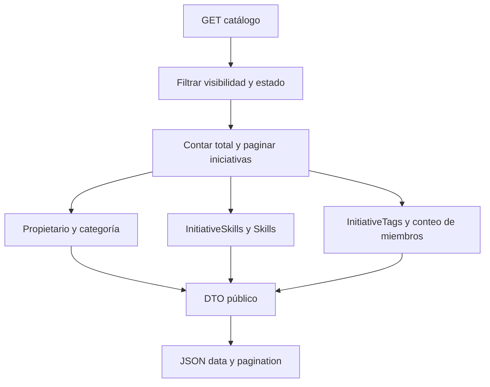
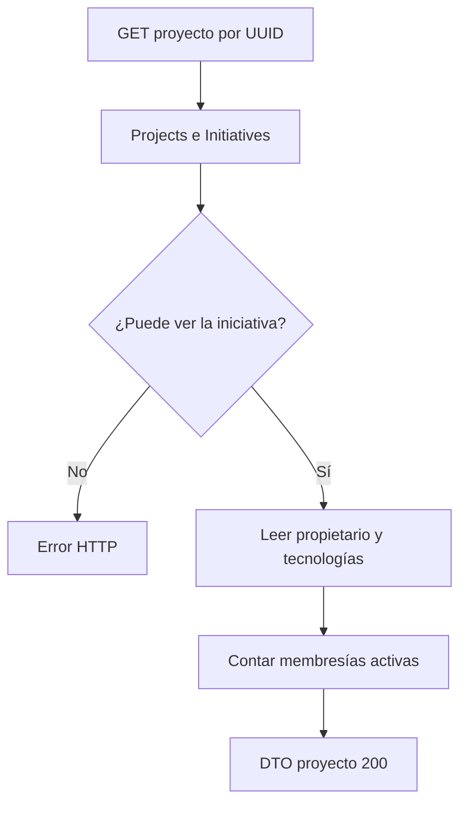

# Diseño de rutas de lectura — Innovation Hub

**SOFT-12 · Tarea 3, Parte B**  
Daniel Campos Sánchez y Francisco José Torres Sandoval.

Las dos rutas elegidas ya existen en el contrato del Avance 2 y permiten acceso sin iniciar sesión. El SQL es un diseño, no código ejecutado. Los ejemplos se construyen con el subconjunto de datos de [modelo-datos.md](modelo-datos.md#paso-5--carga-de-datos); se conserva el contrato JSON de Express, incluido el UUID público como texto. Las consultas usan parámetros, no concatenación de entradas. La API autoriza antes de enviar información; si se presenta un Bearer válido se aplica la política del actor, y un token inválido produce 401 igual que Express.

## 1. GET /api/initiatives

### Ruta y qué devuelve

Ejemplo: `GET /api/initiatives?page=1&size=2`. Devuelve el catálogo paginado de iniciativas visibles: resumen, categoría, competencias requeridas (relación N:M), conteo de miembros, espacios, estado, capacidades, propietario, etiquetas y fechas cuando el actor tiene permiso de detalle. No devuelve `description`, `problem` ni `beneficiaries` en el listado.

Sin sesión, solo aparecen las iniciativas `public` en `published`, `forming_team` o `converted`. La página de prueba contiene una sola iniciativa: Orientación laboral (Id interno 8). Mentorías tecnológicas es institucional y Datos de calidad del aire es privada, por lo que no deben influir en el total anónimo.

### Tablas y recorrido

| Tabla | Uso |
| --- | --- |
| Initiatives | Selección, búsqueda, estado y paginación. |
| Users | Propietario, únicamente id público y nombre. |
| Categories | Identificador público (slug) y nombre. |
| InitiativeSkills | Une iniciativa y competencias, orden del arreglo. |
| Skills | UUID público y nombre de cada competencia. |
| InitiativeTags | Etiquetas en orden original. |
| Memberships | Conteo de miembros activos (incluido el dueño). |



### Consulta SQL

Caso anónimo. Parámetros de la URL ya validados: page >= 1, size entre 1 y 50; el orden del ejemplo es el predeterminado del contrato (`createdAt desc`, desempate por UUID). Primero se pagina la entidad raíz; así un JOIN que devuelva dos competencias no convierte una iniciativa en dos resultados. Se usa `COUNT` antes de `OFFSET`, con los mismos predicados. Los conjuntos devueltos se ensamblan en memoria solo para la página, sin paginar en memoria.

```sql
DECLARE @Page bigint = 1, @Size int = 2;
-- NULL significa que no se solicitó el filtro correspondiente.
DECLARE @Type varchar(10) = NULL, @State varchar(20) = NULL;
DECLARE @Category varchar(80) = NULL, @Skill uniqueidentifier = NULL;
DECLARE @Owner uniqueidentifier = NULL, @HasSpaces bit = NULL;
DECLARE @Q nvarchar(200) = NULL; -- minúsculas, sin tildes y LIKE escapado (~)

SELECT i.Id, i.PublicId, i.Title, i.Type, i.Summary, i.EstimatedMembers,
       i.Visibility, i.State, i.CreatedAt, i.UpdatedAt, i.TitleNormalized,
       c.PublicId AS CategoryPublicId, c.Name AS CategoryName,
       u.PublicId AS OwnerPublicId, u.FirstName, u.LastName,
       mc.MemberCount,
       CASE WHEN i.EstimatedMembers > mc.MemberCount
            THEN i.EstimatedMembers - mc.MemberCount ELSE 0 END AS AvailableSpaces
INTO #Visible
FROM dbo.Initiatives AS i
JOIN dbo.Users AS u ON u.Id = i.OwnerId
JOIN dbo.Categories AS c ON c.Id = i.CategoryId
CROSS APPLY (
    SELECT COUNT(*) AS MemberCount FROM dbo.Memberships AS m
    WHERE m.InitiativeId = i.Id AND m.State = 'active'
) AS mc
WHERE i.Visibility = 'public'
  AND i.State IN ('published', 'forming_team', 'converted')
  AND (@Type IS NULL OR i.Type = @Type)
  AND (@State IS NULL OR i.State = @State)
  AND (@Category IS NULL OR c.PublicId = @Category)
  AND (@Owner IS NULL OR u.PublicId = @Owner)
  AND (@Skill IS NULL OR EXISTS (
      SELECT 1 FROM dbo.InitiativeSkills AS ix
      JOIN dbo.Skills AS s ON s.Id = ix.SkillId
      WHERE ix.InitiativeId = i.Id AND s.PublicId = @Skill))
  AND (@Q IS NULL OR i.SearchText LIKE N'%' + @Q + N'%' ESCAPE N'~')
  AND (@HasSpaces IS NULL OR
       (@HasSpaces = 1 AND i.EstimatedMembers > mc.MemberCount) OR
       (@HasSpaces = 0 AND i.EstimatedMembers <= mc.MemberCount));

-- Total de iniciativas (no de competencias), antes de paginar.
SELECT COUNT(*) AS Total FROM #Visible;

SELECT * INTO #Page
FROM #Visible
ORDER BY CreatedAt DESC, CONVERT(char(36), PublicId) DESC
OFFSET (CAST(@Page AS bigint) - 1) * @Size ROWS FETCH NEXT @Size ROWS ONLY;

SELECT * FROM #Page
ORDER BY CreatedAt DESC, CONVERT(char(36), PublicId) DESC;

SELECT p.Id AS InitiativeId, s.PublicId AS SkillPublicId, s.Name
FROM #Page AS p
JOIN dbo.InitiativeSkills AS ix ON ix.InitiativeId = p.Id
JOIN dbo.Skills AS s ON s.Id = ix.SkillId
ORDER BY p.Id, ix.Position;

SELECT p.Id AS InitiativeId, t.Value
FROM #Page AS p
JOIN dbo.InitiativeTags AS t ON t.InitiativeId = p.Id
ORDER BY p.Id, t.Position;

DROP TABLE #Page;
DROP TABLE #Visible;
```

La implementación futura puede proyectar estos mismos datos mediante EF Core. Para `sort=updatedAt`, `title` o `memberCount`, emplear respectivamente `UpdatedAt`, `TitleNormalized` o `MemberCount` y `ASC/DESC` según la lista blanca del contrato, siempre con desempate estable por UUID y sin interpolar texto SQL del usuario. `totalPages = ceil(total/size)`. El DTO anónimo tiene `canViewDetails` y `canViewTeam` verdaderos; todas las capacidades de modificación falsas. `availableSpaces = max(0, estimatedMembers - memberCount)`.

Si hay sesión válida, el mismo diseño aplica la autorización antes de contar y paginar: incluir públicas, institucionales y resúmenes de restringidas; privadas solo para dueño o miembro. Calcular el acceso a detalle con el dueño y Memberships activas, buscar en `PublicSearchText` cuando no exista permiso de detalle, filtrar por propietario solo si el detalle es visible y omitir propietario, tags y fechas de los resúmenes restringidos. Consultar solicitudes pendientes del actor para `canRequest`. No mezclar datos privados en los resultados públicos.

### JSON esperado (200 OK)

```json
{
  "data": [
    {
      "id": "10000000-0000-4000-8000-000000000008",
      "title": "Orientación laboral",
      "type": "need",
      "summary": "Crear recursos y prácticas guiadas para entrevistas laborales.",
      "category": { "id": "education", "name": "Educación" },
      "skills": [
        { "id": "aaaaaaaa-aaaa-4aaa-8aaa-aaaaaaaaaaa4", "name": "Comunicación" },
        { "id": "aaaaaaaa-aaaa-4aaa-8aaa-aaaaaaaaaa10", "name": "Recursos humanos" }
      ],
      "estimatedMembers": 2,
      "memberCount": 3,
      "availableSpaces": 0,
      "visibility": "public",
      "state": "converted",
      "access": {
        "canViewDetails": true,
        "canEdit": false,
        "canDelete": false,
        "canArchive": false,
        "canRequest": false,
        "canManageRequests": false,
        "canViewTeam": true,
        "canConvert": false
      },
      "owner": {
        "id": "11111111-1111-4111-8111-111111111111",
        "firstName": "Ana",
        "lastName": "Rojas"
      },
      "tags": ["empleo", "entrevistas"],
      "createdAt": "2026-10-23T14:00:00.000Z",
      "updatedAt": "2026-10-28T14:00:00.000Z"
    }
  ],
  "pagination": { "page": 1, "size": 2, "total": 1, "totalPages": 1 }
}
```

El nombre de cada propiedad, el anidamiento y la estructura de paginación corresponden a `servidor/src/dto/initiative.dto.js` y `servidor/src/controllers/initiatives.controller.js`. Códigos adicionales: 400 por consulta inválida, 401 por sesión enviada pero vencida/inválida; una página sin datos devuelve 200 con `data: []`.

## 2. GET /api/projects/{id}

### Ruta y qué devuelve

Ejemplo: `GET /api/projects/50000000-0000-4000-8000-000000000001`. Devuelve el detalle del proyecto Programa de orientación laboral, con iniciativa de origen, propietario, tecnologías, fechas, estado, repositorio y conteo de integrantes activos. Es público porque su iniciativa de origen es pública y se encuentra convertida. No devuelve una lista de miembros ni consulta GitHub: ese consumo externo es responsabilidad del cliente, cuando existe URL.

### Tablas y recorrido

| Tabla | Uso |
| --- | --- |
| Projects | Datos propios y UUID solicitado. |
| Initiatives | Iniciativa de origen y regla de visibilidad. |
| Users | Datos públicos del dueño del proyecto. |
| ProjectTechnologies | Arreglo de tecnologías ordenadas. |
| Memberships | Integrantes activos del equipo de origen. |



### Consulta SQL

El parámetro se valida como UUID antes de consultar. Caso sin sesión: se obtiene únicamente un proyecto con iniciativa pública y estado que permite detalle anónimo. Si no aparece una fila, el servicio distingue inexistencia, recurso privado/borrador/archivado (404) de institucional/restringido (401) con una comprobación interna de metadatos sin devolver datos protegidos. Para un actor autenticado, el servicio autoriza si es dueño o, fuera de borrador/archivada, es miembro activo o la visibilidad es public/institutional; restringida sin membresía devuelve 403 y privada ajena 404.

```sql
DECLARE @ProjectPublicId uniqueidentifier = '50000000-0000-4000-8000-000000000001';

SELECT p.Id, p.PublicId, i.PublicId AS InitiativePublicId,
       i.Title AS InitiativeTitle, u.PublicId AS OwnerPublicId,
       u.FirstName, u.LastName, p.Name, p.Description, p.Objective,
       p.StartDate, p.EstimatedEndDate, p.State, p.RepositoryUrl,
       p.CreatedAt, p.UpdatedAt,
       (SELECT COUNT(*) FROM dbo.Memberships AS m
        WHERE m.InitiativeId = i.Id AND m.State = 'active') AS MemberCount
INTO #AuthorizedProject
FROM dbo.Projects AS p
JOIN dbo.Initiatives AS i ON i.Id = p.SourceInitiativeId
JOIN dbo.Users AS u ON u.Id = p.OwnerId
WHERE p.PublicId = @ProjectPublicId
  AND i.Visibility = 'public'
  AND i.State NOT IN ('draft', 'archived');

SELECT * FROM #AuthorizedProject;

SELECT ap.Id AS ProjectId, t.Value
FROM #AuthorizedProject AS ap
JOIN dbo.ProjectTechnologies AS t ON t.ProjectId = ap.Id
ORDER BY t.Position;

DROP TABLE #AuthorizedProject;
```

El servicio combina la fila principal con las tecnologías, transforma las fechas DATE a `YYYY-MM-DD`, fechas UTC a ISO 8601, y mapea las llaves públicas a cadenas. El conteo usa el equipo de la iniciativa 8: Ana, Elena y Carla (3). Luis está retirado y no se cuenta. Las FK garantizan que la iniciativa y su propietario existen.

### JSON esperado (200 OK)

```json
{
  "data": {
    "id": "50000000-0000-4000-8000-000000000001",
    "sourceInitiative": {
      "id": "10000000-0000-4000-8000-000000000008",
      "title": "Orientación laboral"
    },
    "owner": {
      "id": "11111111-1111-4111-8111-111111111111",
      "firstName": "Ana",
      "lastName": "Rojas"
    },
    "name": "Programa de orientación laboral",
    "description": "Implementación de talleres y recursos para preparar postulaciones y entrevistas.",
    "objective": "Acompañar a participantes durante la preparación de su búsqueda laboral.",
    "technologies": ["React", "Node.js"],
    "startDate": "2026-11-01",
    "estimatedEndDate": "2027-02-28",
    "state": "planning",
    "repositoryUrl": null,
    "memberCount": 3,
    "createdAt": "2026-10-25T16:00:00.000Z",
    "updatedAt": "2026-10-25T16:00:00.000Z"
  }
}
```

La respuesta reproduce `servidor/src/dto/project.dto.js` y `servidor/src/controllers/projects.controller.js`. Un id inválido o query no permitido produce 400; inexistencia o acceso privado produce 404; se conservan 401/403 cuando corresponda. No se exponen identificadores SQL, hashes, correo ni campos internos.
